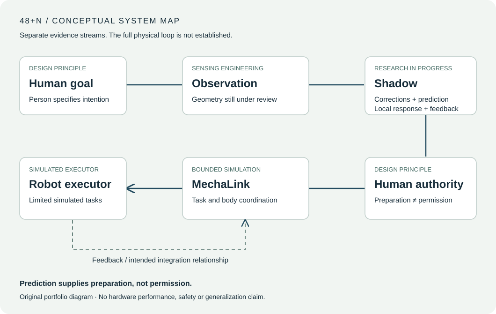

# 48+N
### Beyond One Body — A Human-Centered Embodied Intelligence Research Initiative

**Human specifies the goal; Shadow prepares, MechaLink coordinates embodied realization. Control must still be verified, authorized and fed back.**

I started 48+N to study a practical problem: when a person directs a robot, the system may need to prepare for a movement before it knows what the person will do, but preparation is not permission to act. The research connects human corrections, prediction, robot-local feedback and task decisions across different embodiment capabilities.

**Engineering foundation:** real camera acquisition and software integration, recorded-motion forecasting and baseline evaluation, and bounded SO-101 task execution in MuJoCo. These remain separate evidence streams; a complete physical human-to-robot loop and comparative method superiority have not been established.

[Research site — planned](https://andrealiuz.github.io/48-plus-n/site/index.html) · [Offline HTML source](site/offline.html) · [One-page research brief](RESEARCH_BRIEF.md) · [Research status](RESEARCH_STATUS.md)

## Evidence-backed engineering work

| Domain | Implemented and exercised | Boundary |
|---|---|---|
| **Real sensing** | Acquired real RGB-D observations with D455/D435i cameras and exercised frame, timing and software interfaces. | Independent geometric and anatomical accuracy remain unqualified. |
| **Recorded-motion prediction** | Evaluated GRU-based motion forecasts against simple baselines using recorded motion. | These are measured-reference comparisons, with input availability and baseline choice affecting interpretation. |
| **Robot simulation** | Exercised ordinary SO-101 control in MuJoCo through grasp, lift, transport, placement and retreat. Rendered RGB-D re-observation informed updated target estimates in controlled tabletop cases. | Known scene geometry and simulator ground-truth contact checks still apply. |

A limited native camera-to-prediction-to-software-consumer path has also been recorded. Generated operator-command tests in SO-101 MuJoCo exercised bounded correction, HOLD and the resulting simulated motion and settling. These are **simulation-only functional checks** under known scene assumptions: HOLD is not instantaneous, and real-time operation, human-study benefit and physical-robot advantage have not been established. No original recordings, private implementation, unpublished numerical comparisons or research figures are distributed here.

## Two research layers

| Layer | Research role | Current scope |
|---|---|---|
| **Shadow** | The proposed low-level human–robot loop: rapid human reactions and corrections, short-horizon prediction, robot-local feedback/protection, and feedback to the operator | Recorded-motion evaluation and software integration have been exercised; integrated physical-loop benefit, independent measurement validity and reliable anticipation remain open. |
| **MechaLink** | Human task goals and revision, task semantics, ability/embodiment matching and authorised execution | Bounded simulated task and visual re-observation engineering; a distinct high-level method advantage over ordinary baselines is unproven. |

The diagram explains the intended relationship between the layers. Its feedback arrow is conceptual; separate engineering tests do not establish a completed physical closed loop. Prediction supplies preparation, not permission.

## Research questions

- When does a forecast add useful preparation beyond a simple baseline, and when should an interface expose missing or uncertain observations?
- What can remain meaningful about a task goal when the body's capabilities change?
- Which independent measurements and physical outcomes are needed before these layers can support a stronger integrated claim?

The [one-page brief](RESEARCH_BRIEF.md) connects these questions to the engineering foundation and prospective PhD direction. Further reading: [evidence overview](docs/evidence_overview.md), [methods and limitations](METHODS_AND_LIMITATIONS.md), [research questions](docs/research_questions.md) and [public roadmap](docs/public_roadmap.md).

## The name

**46 / +2 / +N** is a design metaphor: the 46 chromosomes typical of human somatic cells represent the biological body; the two functional layers are Shadow and MechaLink; N represents possible additional bodies, tools and interaction capabilities. The naming was partly inspired by Tool’s song *Forty Six & 2*, without using its artwork or lyrics. It is not a claim that people have 48 chromosomes or that unbounded robot skills have been demonstrated.

## Contribution and dependencies

This is independent research conceived and carried out by the author (@ANDreaLiuz), from study design and data collection through implementation, testing and interpretation. No other student or faculty researcher co-developed the work. MuJoCo provides simulation; existing sensing and numerical tools provide established capabilities. SO-101 resources from TheRobotStudio, MuJoCo Menagerie and the LeRobot ecosystem underpin the development stack. Their models and algorithms are not claimed as original contributions. See [authorship and scope](AUTHORSHIP_AND_SCOPE.md) and [dependency attribution](DEPENDENCIES_AND_ATTRIBUTION.md).

The portfolio text and original SVGs were prepared with AI assistance. No private research implementation, participant record or third-party robot asset is redistributed.

## Read and explore

The research page uses local HTML, CSS and original SVGs. Download the repository and open `site/offline.html` in a modern browser for an offline preview; no build, account or package installation is required.

**Research in progress · Selected frozen engineering evidence reviewed 28 October 2026.** Robotics manuscripts are in preparation; submission or acceptance is not claimed. No software or content license has been selected. Publication and reuse terms require the author's decision.

These website addresses are planned release destinations and have not been verified as active. The offline HTML source is a file view on GitHub; download the repository and open `site/offline.html` to run it locally. Markdown notes remain local files in that edition.
